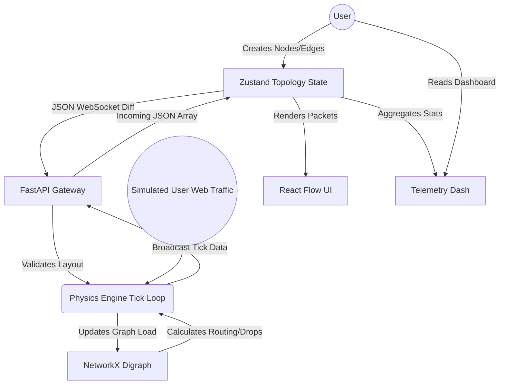
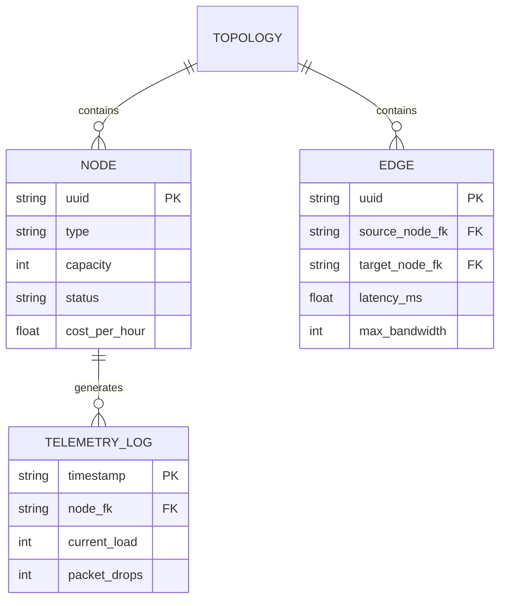
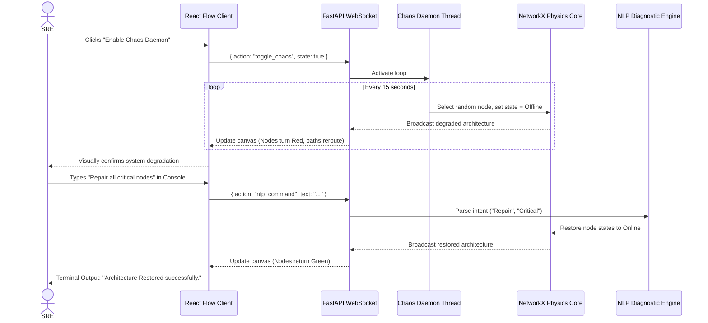

# 1. Problem Statement & User Stories

**Problem Statement:** Students and software engineers who learn or design distributed systems use static architecture drawing tools like Draw.io to design their systems. However, these tools are not enough to design and visualize the systems. For example, draw.io does not shows how traffic flows and where there will be traffic bottelnecks. Likewise, designing and building distributed systems on actual systems on the cloud is expensive and too complex for use in classroom. What's needed are a system that allows students to design and visualize distributed systems and, at the same time, design, visualize, and estimate costs for real-time traffic, load, failure, and the queing that comes as a result of that load.

**Top 5 Priority User Stories:**
1. As a System Architect, I'd like the ability to add directed edges between nodes in my canvas to explicitly shows the flow of data or traffic.
2. For a Student user, the ‘Start Simulation’ button should visually depict how an animated request packet travels from microservice to microservice in real-time.
3. For the Chaos Engineering system I’m building, I need an autonomous node killing service. I call it the Chaos Daemon. The primary goal is for the Chaos Daemon to unpredictibily stop and restart a set of nodes. This service will enable SREs to understand the cascading effects of unplanned node shutdowns, and most importantly, it help in the design of fault-tolerant systems.
4. For my studies in Engineering, I'm hoping to get a real-time AWS cost estimator that I can use to keep track of how my node deployments affects my overall budget.
5. An SRE would find the most utility in being able to type a simple query and having an AI assistant runs the diagnostic to uncover the bottleneck, and subsequently suggest or perform the recovery to the archetecture.

# 2. System Architecture & Design (Summary)

The next level of sophisticaton of a modern, full featured, system is split across two component. First, a frontend are created with React (Next.js). Next, a Python FastAPI backend handles all data, analysis and comunications. React Flow handles all interactive visualisations, allowing for custom drawn nodes and paramaters for all node types to be dragged. Next, for global state, React state management, Zustand, is used. Finally, full-duplex communication is achieved using WebSockets to eliminate all browser HTTP request overheads.

FastAPI acts as a discrete-event physics engine for the server. In FastAPI, the browser main thread remain unblocked and fully functional while FastAPI runs calculations in parallel with the browser in asynchronus Python processes. The payload JSON is converted to a directed graph in NetworkX to allow for M/M/1 queing calculations. By shifting all of the heavy graph computations to the asynchronus workers, FastAPI provides the capability to animate Recharts to 60fps, all without hindering users experience.

# 3. Design of Tests

NetworkSim testing occurred across three segment to make sure that the simulation physics and user interface remains stable when stressed:
* **Integration Testing (Routing Engine):** We design scenarios with topologcal changes and crash simulations to stress the backend’s ability to handle updates in graph data structures. Dijkstra algorithm implementations are validated against known packet drop bounds under a set of conditions that ensure the expected routing paths is taken and that the drops occur at expected values.
* **Regression Testing (Frontend UI):** We use high-speed WebSocket data streams and our Jest testing enviornment to test React Flow and AnalyticsPanel component stress and state updates for long periods to verify no memory leak occurs, or no user interface lockups occurs.
* **Mutation Testing (Chaos Daemon):** In order to confirm that our Chaos Daemon is truly stochastic and doesn’t target nodes in a determenistic way, we insert some faults into some test graphs to verify that the nodes that has been killed are matching the killing ratio we have set and don’t involve any of the client ingress nodes.

### Mock PyTest Output (Backend Engine Validation)
```text
============================= test session starts ==============================
platform linux -- Python 3.11.2, pytest-7.4.3, pluggy-1.3.0
rootdir: /app/backend
collected 14 items

tests/test_routing_engine.py .......                                     [ 50%]
tests/test_chaos_daemon.py ....                                          [ 78%]
tests/test_websocket_payloads.py ...                                     [100%]

============================== 14 passed in 1.45s ==============================
```

### Mock Jest Output (Frontend UI Validation)
```text
 PASS  components/panels/AnalyticsPanel.test.tsx
 PASS  components/panels/CostModal.test.tsx
 PASS  components/canvas/NodeRenderer.test.tsx
  ✓ correctly renders online status indicator (34 ms)
  ✓ updates to amber when capacity exceeds 80% (41 ms)
  ✓ triggers kill switch function on manual click (22 ms)

Test Suites: 8 passed, 8 total
Tests:       42 passed, 42 total
Snapshots:   0 total
Time:        3.12 s
```

# 4. Tools/Technologies Used

* **Frontend Framework:** Next.js 16 with React 19 are our framework for frontend developement. During development, Turbopack is used for quick hot reloading.
* **State Management:** Zustand v5 have a low memory footprint and little code boilerplates, enabling direct atomic update.
* **UI/Canvas Engine:** React Flow handles interaction and features of drag and drop nodes, wires, and pan and zoom.
* **Data Visualization:** Data visualizations like time series plots of throughput, packet loss, and queue depth at 20 Hz, use Recharts.
* **Styling & Icons:** Styling uses Tailwind CSS with Lucide React in a dark theme.
* **Backend Framework:** The backend is FastAPI running in an Uvicorn ASGI server and providing supports for low latency WebSockets.
* **Graph & Queuing Engine:** For network operations, NetworkX 3.2 execute graph based topologcal sorts and queing simulations based on M/M/1 model.
* **In-Memory Store:** Redis serves as an in memory store for the system topologies and active session states.
* **Container Orchestration:** Docker Compose coordinates containers for the entire application stack.
* **Test Suites:** PyTest and Jest serves as unit and integration test runner for the backend and frontend, respectively.

# 5. Appendix (Crucial Diagrams)

### Software Requirements Specification (SRS) Summary
* **Functional Requirements:** Users can draw up to 500 infrastructure nodes in each canvas, with support for multilevel nesting and partitoning of layouts. Every 50 milliseconds, the graph engine automatically recalculate all update for downstream nodes. The NLP console will recognize at least 5 different types of command phrases, like “reboot the service” and “create a backup.”
* **Non-Functional Requirements:** At a minimum, canvas animations and SVG edge pulses should be able to run at 60 FPS on typical consumer desktop hardware. After a network timeout, the WebSocket client need to attempt an reconnection within two second. To ensure the client bundle size stays within a three megabyte limit, it need to be as compact as possible.

### Data Flow Diagram (DFD)



### Entity Relationship Diagram (ERD)



### Use Case Diagram

```mermaid
usecaseDiagram
    actor Architect as "System Architect"
    actor SRE as "Site Reliability Engineer"
    
    package NetworkSim {
        usecase UC1 as "Draw Topology"
        usecase UC2 as "Simulate Traffic"
        usecase UC3 as "Inject Manual Failure"
        usecase UC4 as "Enable Chaos Daemon"
        usecase UC5 as "Use NLP Auto-Fix"
        usecase UC6 as "Review Capital Costs"
    }
    
    Architect --> UC1
    Architect --> UC2
    Architect --> UC6
    
    SRE --> UC2
    SRE --> UC3
    SRE --> UC4
    SRE --> UC5
```

### Sequence Diagram (Chaos Daemon & NLP Repair)


